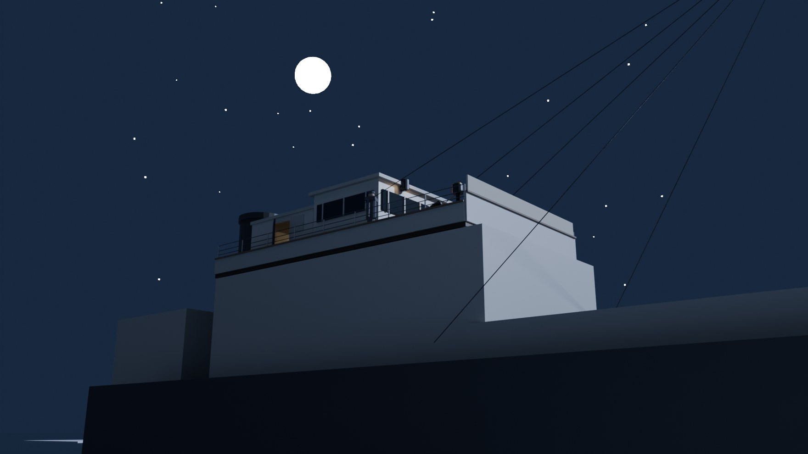

# Week 8 · Californian 号，中班 00:15–02:20

> 一个历史模拟：1912 年 4 月 15 日凌晨，你站在「加州人号」的桥楼上，是二副手下的中班学徒。
> 远处一条船在冰区里停着，先闪灯，后放火箭。你能看、能问、能记——你不能改变这条船的方向，
> 也不能让船长起床。

**场景是 Blender 做的。** 桥楼、前甲板、海图室三处，各渲染成一张 360° 全景，
网页里可以拖动转身、点东西看、走到别的舱室、跟二副说话。
全景里没有的那两样东西——远处那条船的桅灯、一枚枚升起的白色火箭——是网页实时画上去的，
按模拟的钟点出现。



## 情境（三句话）

1. 你在 1912 年 4 月 15 日凌晨的「加州人号」桥楼上当中班学徒，能看、能问、能往值班簿上写字；
   海图室的门在两点以前关着。
2. 五六英里外那条船先闪灯、后放八枚白色火箭；二副把这件事报给船长，船长只让他「继续用莫尔斯灯叫」。
3. 走的时候该带走的不是「他应该过去」，而是：一个错误的判断，可以由许多各自都合理的小延迟堆起来；
   而记录，只是被抄下来的那一部分。

**为什么不是电影？** 因为电影会让你同时看见两边：Titanic 在沉，Californian 在等。
这个模拟只给你桥楼上那个人当时能看见的东西：一盏桅灯、八枚白火箭、一句「继续用莫尔斯灯叫」，
和一个睡在海图室里的船长。**把「他本该过去」这句话变得廉价，是电影的强项；把这个小时里
每一个都不像错的判断摊开给你看，是模拟的强项。** 详见 [`research/why-not-a-film.md`](research/why-not-a-film.md)。

```
[00:20] Stone: Flickering, is it. Put the glasses on her yourself before you make up your mind what it is.
[01:05] 你:     That is five rockets now, sir. Shall I call the captain?
[01:05] Stone: Five, you say. I make it five myself. No — hold off. I'll have the glasses on her again first...
[02:00] Stone: Go down to the master. Wake him. Tell him altogether we have seen eight of these white
               lights like white rockets...
[02:08] 船长:  Were they all white? Any colour in them at all? / What is the time?
[02:20] 世界:  两点二十分。你什么也不知道。
```

上面这几段是真实调用跑出来的，不是写好的台词。原样记录在
[`research/demo-transcript.md`](research/demo-transcript.md)，每一次调用的 prompt、回复、
token 与费用在 [`research/calls.jsonl`](research/calls.jsonl)。

## 先跑起来

```powershell
cd week8
python sim\server.py            # 需要 Python 3，只用标准库
# 打开 http://127.0.0.1:8765          ← 3D 场景（Blender 全景）
# 或者 http://127.0.0.1:8765/text     ← 同一局的纯文字版
```

**在场景里：** 按住拖动或按 ← → 转身；滚轮缩放；画面上亮着的标签是「看它」，
绿色虚线标签是「换地方」（海图室的门、上桥楼的梯子）。右边是二副的话、值班簿、说话与动作。

- 有 `DEEPSEEK_API_KEY`：每个回答都是**真调用**，页眉显示 `真调用 · deepseek-flash`。
- 没有密钥：`WEEK8_MODE=fixture python sim\server.py` 重放上次录下的回答，页眉写
  `录制重放（不是真调用）`，绝不冒充。没录过的句子直接拒绝（409），不拿别的话顶上。

**重建场景**（改一处、渲一张，约 5 分钟；本机 RTX 5070 走 OptiX）：

```powershell
& "C:\Program Files\Blender Foundation\Blender 5.2\blender.exe" `
  --background --factory-startup --python scene\build_bridge.py -- --glb
```

它会重写 `scene/renders/` 里的三张全景、两张剧照、`bridge.blend`、`bridge.glb`，
以及网页用来摆标签的 `hotspots.json`（每个物体的方位角／仰角，由相机矩阵算出来，不是手摆的）。

自检（不联网、不花钱）：

```powershell
python code\check_sim.py       # 21 项：世界规则、模型 JSON、无密钥不冒充、史料可查、费用算对、HTTP 冒烟
python data\verify_kb.py       # 38 条事实，逐一核对引文在原文里的位置
```

本模拟会读 Week 3&4 的两份原文：`../week3&4/sources/raw/british-inquiry-….txt` 与
`beesley-….txt`。仓库结构不变就不用管；挪了地方就设 `WEEK8_SOURCES` 指向那个目录。

## 场景里有什么

| 位置 | 看得见什么 | 等级 |
|---|---|---|
| 桥楼 · 右舷翼 | 罗经柜、机舱车钟、莫尔斯灯、双筒望远镜、传声筒、船钟、值班簿、二副 Stone、轮船舷墙与栏杆、冰区、星空 | 物件与位置=**inferred**（按同时代商船照片布置）；「桥楼／海图室／莫尔斯灯／传声筒／罗经」=**evidenced** |
| 海图室 | 海图桌、铺开的海图、油灯、墙上的钟、舷窗、半开的门、坐在桌后的船长 | 房间与门=**evidenced**；陈设与尺寸=**inferred**；门开着=**invented** |
| 前甲板 | 舷墙、桅与支索、绞车、系缆桩、舱口、身前的冰 | **inferred**（报告只说到甲板、冰、专利计程仪零件） |
| 远处的来船 | 一盏闪动的桅灯、一枚枚升起的白色火箭 | 网页**实时**画出（不是渲染进全景）；位置由 `hotspots.json` 的方位角决定 |

三张全景：`scene/renders/pano_bridge.jpg`、`pano_foredeck.jpg`、`pano_chart_room.jpg`（3072×1536，各 150–300 KB）。
两张剧照：`still_exterior.jpg`、`still_chart_room.jpg`。模型：`bridge.blend`（可重建）、`bridge.glb`（745 KB）。

## 这一局里有什么

| 是什么 | 在这份作业里的位置 |
|---|---|
| 情境 | 1912 年 4 月 15 日 00:15–02:20，Californian 桥楼／海图室／前甲板 |
| 场景 | Blender：`scene/build_bridge.py` → 三张 360° 全景 + `hotspots.json` |
| 角色（agentic） | 二副 Herbert Stone：自己的目标、记忆、感知与动作；由模型决定说什么、做什么 |
| 剧本化的人 | 船长 Stanley Lord：他的四句话来自报告原文，所以不许模型即兴 |
| 你 | 中班学徒 James Gibson，二十岁；你的名字与年龄来自他的证词 |
| 知识库 | [`data/californian_kb.json`](data/californian_kb.json)：38 条事实，每条带 locator |
| skill | [`skills/californian-watch-officer/SKILL.md`](skills/californian-watch-officer/SKILL.md)：Stone 是谁、能知道什么 |
| 工具调用 | 模型只能提一个动作（observe / call_up / speak / send_down / nothing），由世界执行或拒绝 |
| 真实 API | `sim/model.py`，DeepSeek `deepseek-flash`，每次调用写进 `research/calls.jsonl` |
| 一条真正的规则 | 世界不是模型：时间、冰、火箭、门锁、船长的回答、值班簿行数，全在 `sim/world.py` 里 |

## 目录

```
week8/
├── README.md                     你在这里
├── questions.md                  这一轮没解决的问题
├── scene/
│   ├── build_bridge.py           Blender 建模 + 渲染 + 导出 hotspots.json（全部代码，可重建）
│   └── renders/
│       ├── pano_bridge.jpg       桥楼 360°（网页里的主场景）
│       ├── pano_foredeck.jpg     前甲板 360°
│       ├── pano_chart_room.jpg   海图室 360°
│       ├── still_exterior.jpg    剧照：从水面看桥楼
│       ├── still_chart_room.jpg  剧照：海图室里
│       ├── hotspots.json         每个热点的方位角/仰角 + 相机位置
│       ├── bridge.blend          Blender 源文件
│       └── bridge.glb            导出的模型（745 KB）
├── sim/
│   ├── world.py                  世界：地点、物件、时钟、事件、规则、值班簿、结局
│   ├── stone.py                  角色 Stone：记忆、感知、动作清单、JSON 校验、 hindsight 检查
│   ├── model.py                  真调用 + 计费（含峰谷价与缓存命中价）
│   ├── paths.py                  到哪里找 Week 3&4 的原文
│   ├── server.py                 标准库 HTTP：/ 场景、/text 文字、/api/*、/scene/* 全景图
│   ├── static/scene.html         3D 场景页（原生 JS：全景拖动、热点、实时光点与火箭）
│   ├── static/index.html         文字版（同一局，可键盘玩）
│   └── fixtures/stone_recorded.json   录制的回答，离线重放用
├── data/
│   ├── californian_kb.json       知识库：38 条事实 + 出处 + 等级
│   └── verify_kb.py              逐条核对引文（--fix 可重写 locator）
├── code/
│   ├── check_sim.py              21 项自检
│   └── run_demo.py               跑一局，留下 calls.jsonl / 剧本记录 / 离线替身
├── skills/californian-watch-officer/SKILL.md
├── sources/
│   ├── raw/README.md             为什么这里是空的（见「困难」）
│   └── processed/tip-day7-extracts.txt   逐字摘录的 Day 7 证词
├── research/                     why-not-a-film / sources / parts-table / tools-and-ai /
│                                 difficulties / verification / cost / calls.jsonl / demo-transcript
└── shots/                        浏览器截图——见「诚实的边界」
```

## 四个部件怎么拼起来

老师给的四个部件，这次是这么接上的：

1. **agent + skill**（Week 3–5）：`skills/californian-watch-officer/SKILL.md` 写 Stone 的身份、
   已知、未知与判断方式；`data/californian_kb.json` 里标 `"who": ["stone"]` 的 28 条事实，
   就是他能想起来的东西，每条带出处。别的 10 条标 `later`，**永远不进他的 prompt**——
   `code/check_sim.py` 的 E1 会因此失败。
2. **tool calls**（Week 4）：模型只能返回一个动作，`send_down` 在火箭不足三枚时会被世界拒绝；
   `report_master` 根本不在动作表里——报告船长是记录里的事，不是模型能改的事。
3. **知识库**（Week 3–4）：38 条事实，`source` + `locator` + `quote`，`verify_kb.py` 逐条查证。
   引文在原文里找不到，事实就不许加载。
4. **API**（Week 5）：真调用，JSON 模式，`response_format` + prompt 里出现 "JSON"，
   每次调用写一行日志，费用按官方价目表算（含峰谷与缓存命中）。

**第五个是这一周加的**：Blender 里把桥楼做出来，渲成全景，网页把它当场景用。
全景动不了，所以网页补两样动的：那盏桅灯，和升起又熄掉的火箭——它们由世界的时钟驱动，
和文字版里的「又一枚白色火箭」是同一个事件。

## 史实与分级

完整表在 [`research/parts-table.md`](research/parts-table.md)。摘要：

- **evidenced**：船停在冰区（10.20）、来船与灯、八枚火箭、1.10 的传声筒问答原文、
  2.00 派学徒的话、2.05 船长的三个问题、2.40 的第二次报告、法庭的判词——全部有 locator。
  桥楼、海图室、莫尔斯灯、传声筒、罗经、舷窗：报告与证词里都有。
- **inferred**：桥楼与海图室的具体尺寸与陈设（按同时代商船照片）、值班簿抄进航海日志的规则、
  火箭的具体间隔（报告只给「12.45–1.45 之间共约八枚」）。
- **invented**：动作的时间成本、页面把玩家的中文当作已译成英语说出、hindsight 检查的词表、
  `send_down` 的提前分支、海图室的门半开（让门外的夜光进来）、网页上实时画出来的火箭。

## 工具与 AI 的分工

摘要见 [`research/tools-and-ai.md`](research/tools-and-ai.md)。一句话：
**AI 写代码、建场景、写台词、写文档；史料的定位、数字、边界由脚本与人工核。**
模型只被允许扮演一个人，禁止当叙述者；它说的每句话进日志，说漏了 1912 年不该知道的事会被标出来。
Blender 由 `scene/build_bridge.py` 无界面驱动（`--background --python`），
建了什么、渲了几张、改了几轮，都写在那份脚本与 `difficulties.md` 里。

## 花费

一局（11 个动作、4 次调用）：**输入 6,396 tok / 输出 426 tok / $0.000669**。
分项在 [`research/cost.md`](research/cost.md)。渲染不花钱：本机 GPU，约 5 分半一整套。

## 真实的困难

详见 [`research/difficulties.md`](research/difficulties.md)。最要紧的两条：

- **第一版设计是错的。** 原想让玩家在 1912 年伦敦调查庭的走廊里等 Beesley 被传唤——
  查证人索引后发现他从未在该庭作证。设计整个作废。
- **全景里的东西会「藏进」盒子里。** 二副一开始站在实心轮船舱体内部（渲染里根本看不见），
  海图桌与船长重叠，桥面与甲板顶面同高导致 z-fighting。这些只有渲出来看才知道。

## 诚实的边界

- **浏览器截图还没有**：这台机器起不来 headless 浏览器（命名管道被挡），所以 `shots/` 是空的。
  Blender 的剧照在 `scene/renders/`，网页渲染只在 Node 里做过语法检查、用 HTTP 走过同一串接口。
  页面本身要在你的浏览器里打开才算验证过——这正是需要你帮忙看一眼的地方。
- **不是 Unity**：这台机器上没有 Unity（装不了、要登录），所以场景用 Blender + 一个网页前端。
  老师列的三种里，Blender 与「网页（原生 JS）」都算，Unity 只是「最容易让人走一圈」的那条路；
  这里用全景 + 热点代替了走路，代价与收益写在 `research/why-not-a-film.md` 第 3 节。
- **没有 3D 实时漫游**：全景是渲染好的图，不能自由走动；三处之间靠热点跳。
- **一行代码都没有改 Week 3&4**：本文件夹只读那两份原文。
